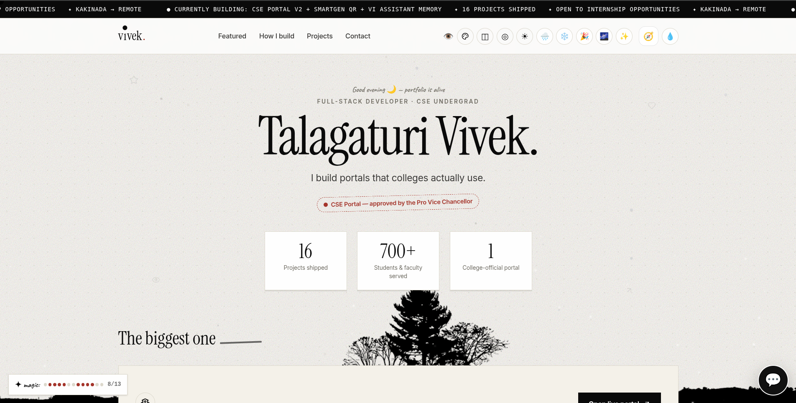
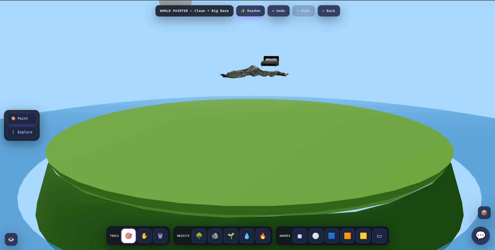
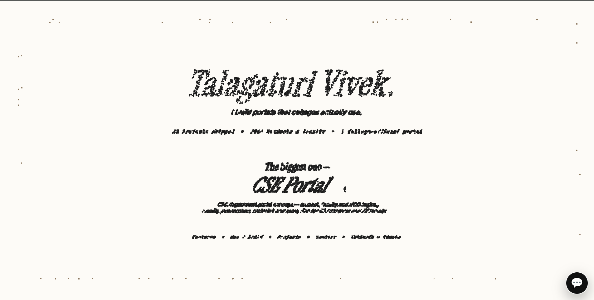
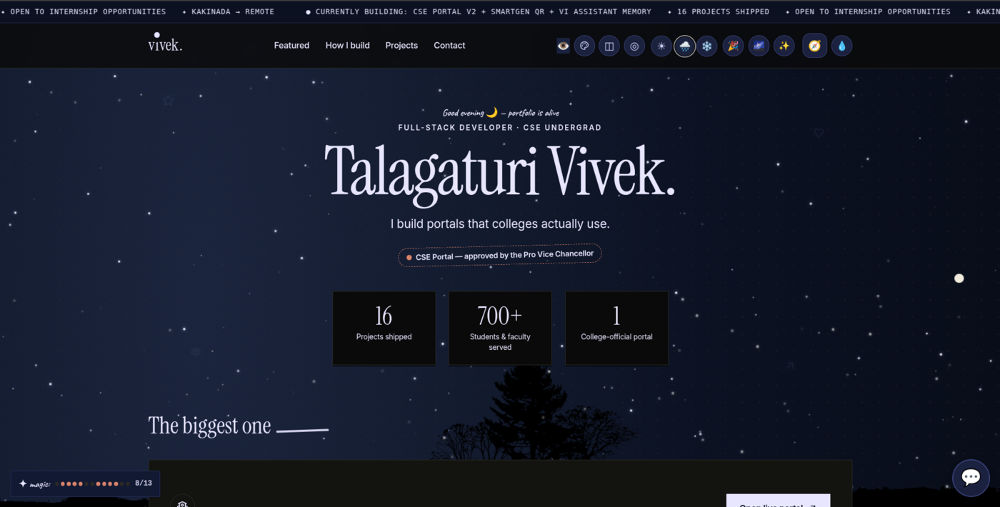
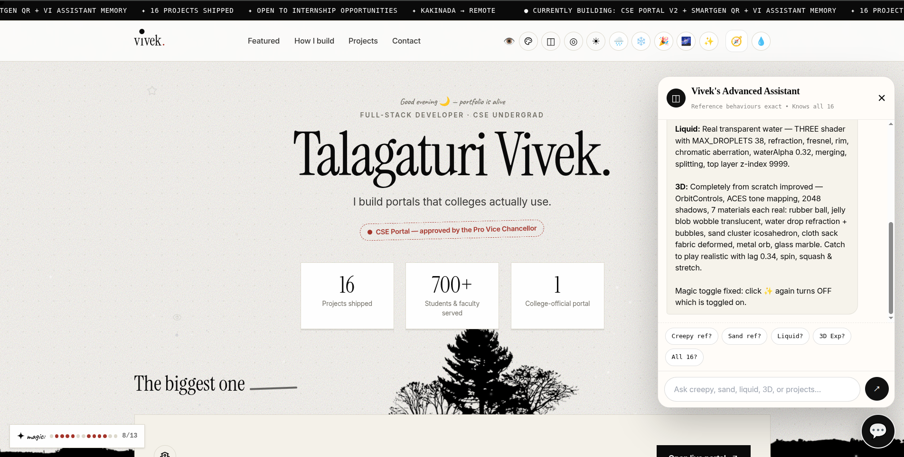

# 3D Interactive Portfolio

An immersive 3D physics sandbox portfolio built with Three.js and WebGL. Explore realistic objects, paint your own world, and hunt for 13 hidden secrets.

**Live demo:** https://talagaturi-vivek.pages.dev



## Features

- **7 interactive object types:** Rubber Ball, Jelly Blob, Water Drop, Sand Cluster, Cloth Sack, Metal Orb, and Glass Marble, each with its own physics behavior
- **Sand mode:** 8,500 particles that form portfolio text, flow with the mouse, and scatter on click
- **World Painter:** a large base ground where you place objects and shapes, move, resize, rotate, recolor, duplicate, and undo or redo
- **Day/Night cycle** with smooth fog, sky, and lighting changes; the campfire glows brighter at night
- **Weather:** rain with splashes, thunder with flash and screen shake, and a sunny mode
- **13 hidden secrets** with a clue command palette (press `?` or type "clue" in the chat)
- **220-star twinkling starfield** background
- **Explore mode** with scale views from Human to Ant and Mosquito
- **GLB / GLTF / OBJ import** by drag and drop; models sit on the ground
- **View tools:** 360° views, auto-orbit, zoom, FOV, wireframe, shadows, grid, focus, and screenshot
- **Built-in AI assistant** that answers questions about my projects
- **Installable PWA**

## Screenshots

| World Painter | Sand mode |
|---|---|
|  |  |

| Day/Night + weather | AI assistant |
|---|---|
|  |  |

## Tech stack

Three.js · WebGL · JavaScript · Physics engine · GLB/GLTF loaders · PWA (service worker)

## Run locally

```bash
git clone https://github.com/24B11CS433vivek/Talagaturi-vivek.git
cd Talagaturi-vivek
python3 -m http.server 8000
```

Open http://localhost:8000.

### Adding your own 3D models

1. Create a `models/` folder next to `index.html`.
2. Put a `.glb` file in it (around 800 kB works best).
3. Open **World Painter**, then **MY MODELS**, and click your model to place it.
4. Use Small / Normal / Big / Huge to resize.

## Controls

| Action | Control |
|---|---|
| Orbit | Drag |
| Zoom | Scroll |
| Spawn object | Click |
| Delete / duplicate | `Del` / `Ctrl+D` |
| Turn off all magic | `Esc` |
| Open clue palette | `?` |

## Author

**Talagaturi Vivek**: 3rd-year B.Tech CSE, Aditya University
[LinkedIn](https://www.linkedin.com/in/talagaturi-vivek) · [GitHub](https://github.com/24B11CS433vivek) · vivektalagaturi@gmail.com
